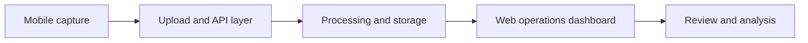

# KAWA AI: Connected Vehicle Data Platform

*A personal portfolio case study about work on a company product. This repository does not contain company source code, customer data, internal documentation, credentials, or deployment configuration.*

## Product context

The product connects mobile data collection with cloud processing and a web-based operations experience. Users need to move from an on-device session to uploaded records and a clear view of the resulting journey data.

## Product demos

- [KAWA AI website](https://kawaai.com/) — public product overview.
- [SaaS test environment](https://saas-test.kawaai.com/) — operations interface; some pages may require an account.
- [Mobile web test environment](https://app-test.kawaai.com/me) — app-facing interface; some pages may require an account or device connection.

These are live company-operated environments. Availability and visible content may change. The mobile link intentionally omits a device identifier.

## My work

I contributed to the web and mobile-facing product experience, API integration, and the workflows that connect captured data to operational views. My frontend work includes React and TypeScript interfaces, reusable UI patterns, data visualization, and integration across application boundaries.

The broader product is built by a team. This case study describes the parts of the work I can discuss publicly; it does not claim sole ownership of the platform or its backend and mobile components.

## Problem-solving approach

1. Map the complete user journey, from capture and upload to processing status and review.
2. Define clear contracts between mobile, API, processing, and SaaS views.
3. Make long-running and failure states visible so users know what happened and what to do next.
4. Validate changes in a test environment before release, and document rollback paths for operational changes.

## Conceptual flow

This diagram intentionally omits internal services, endpoints, storage locations, customer information, and implementation details.

## Relevant skills

React · TypeScript · mobile/web integration · API contracts · operational dashboards · data visualization · release validation

For a discussion of the product or my exact contribution, please contact me through my GitHub profile.

© 2026 Deng-summer. This case study is a personal portfolio summary, not official company documentation.
