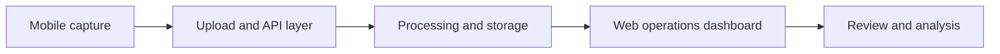

# Connected Operations Platform: Mobile-to-Cloud Workflow

*A personal portfolio case study about work on a team-built product. This repository does not contain company source code, customer data, internal documentation, credentials, or deployment configuration.*

## Product context

The product connects mobile data collection with cloud processing and a web-based operations experience. Users need to move from an on-device session to uploaded records and a clear view of the resulting journey data.

## My work

I contributed to the web and mobile-facing product experience and the API integrations that connect captured data to operational views. Three concrete examples illustrate the work:

| Problem | Approach | Observable result |
| --- | --- | --- |
| A mobile upload can be pending, in progress, failed, completed, or missing; a single generic status leaves users unsure what to do. | The React/TypeScript upload view maps cloud and native-bridge states into distinct UI states, displays progress and errors, and offers a resume action when a failed file can be retried. | Users can identify the affected file and continue an interrupted upload instead of starting the entire journey again. |
| Journey review needs to connect operational records to location and event context. | The web experience combines journey details with map routes, event markers, and API-backed data views. | A reviewer can inspect a journey and its events in one flow, rather than comparing separate raw files. |
| Changes span mobile, API, processing, and SaaS interfaces, so a locally successful change may still break the full journey. | I use explicit API contracts and test-environment validation, with release and rollback notes for operational changes. | Cross-system behavior is checked before wider release, and a failed release has a documented recovery path. |

These are workflow and delivery outcomes, not claims of measured revenue or performance improvements. I can discuss the exact scope of my contributions in a project conversation.

The broader product is built by a team. This case study describes the parts of the work I can discuss publicly; it does not claim sole ownership of the platform or its backend and mobile components.

## Problem-solving approach

1. Map the complete user journey, from capture and upload to processing status and review.
2. Define clear contracts between mobile, API, processing, and SaaS views.
3. Make long-running and failure states visible so users know what happened and what to do next.
4. Validate changes in a test environment before release, and document rollback paths for operational changes.

## Conceptual flow

This diagram intentionally omits internal services, endpoints, storage locations, customer information, and implementation details.

## API and data view

The private platform repository includes a FastAPI service for reading uploaded journeys, their events, and related files. The backend separates API routes from domain logic and data queries, so the web interface can request a journey summary, inspect event context, and access associated media without treating raw capture files as the user interface. Import and processing scripts prepare data before it is presented for review. This is a high-level description of the team's system, not a claim that I built every component alone.

| Problem | Publicly describable solution | Result a reviewer can verify |
| --- | --- | --- |
| Captured data arrives as separate journey, event, and media records. | Expose a consistent read model through API routes and connect it to a web review flow. | A reviewer can navigate from a journey to its related events and files. |
| Processing takes place after mobile capture. | Show upload and processing states in the product experience. | The interface makes pending, failed, and completed work distinguishable. |

The original frontend, backend, processing, and mobile source remain private because they include confidential project material. Separately reviewed, non-confidential examples may be published later; this case study does not include the production code.

## Relevant skills

React · TypeScript · mobile/web integration · API contracts · operational dashboards · data visualization · release validation

For a discussion of the product or my exact contribution, please contact me through my GitHub profile.

© 2026 Deng-summer. This case study is a personal portfolio summary, not official company documentation.
